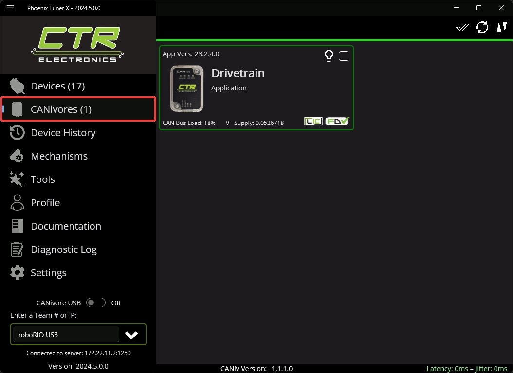
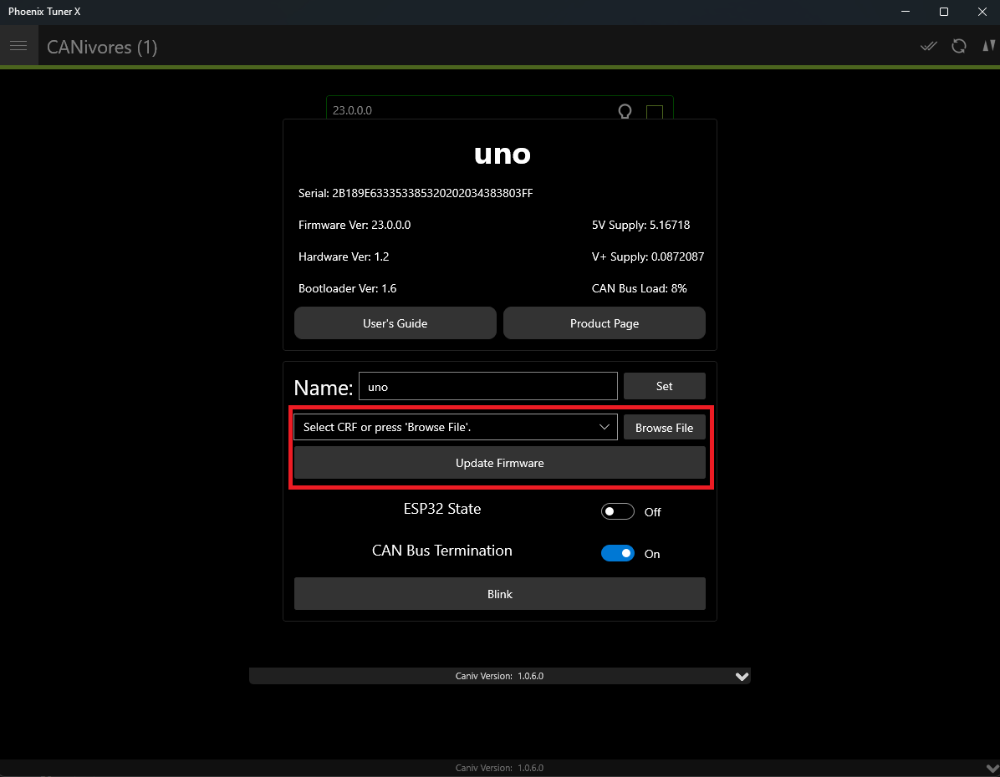
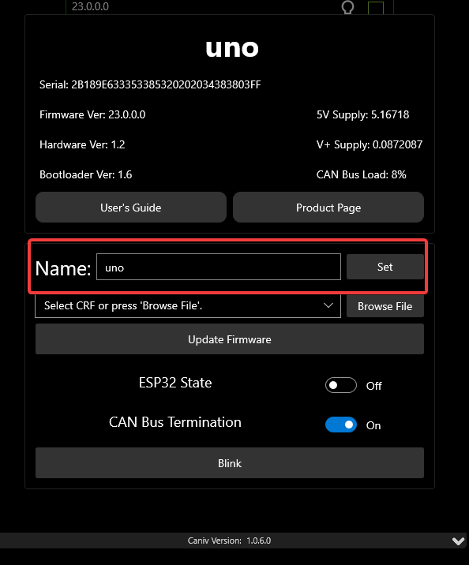

CANivore® Setup
===============

Installing for roboRIO
----------------------

.. note:: Phoenix Tuner X requires a 2023 roboRIO image or newer to configure the CANivore®.

No additional steps are required. The roboRIO comes with the ``canivore-usb`` kernel module pre-installed.

Installing for Linux (non-FRC)
------------------------------

See :ref:`docs/installation/installation-nonfrc:canivore® installation` for information on setting up your Linux system for use with a CANivore®.

Viewing Attached CANivore® Devices
----------------------------------

Attached CANivore® devices can be viewed in Phoenix Tuner X by selecting the :guilabel:`CANivores` page from the left-hand sidebar. You can specify the target system in the :guilabel:`Target IP or Team #` text box.

.. note:: The Phoenix Diagnostic Server must be running on the target system to use the :guilabel:`CANivores` page.

.. tip:: If you are connecting to CANivore® devices on your local Windows machine, you can enable the "CANivore USB" toggle and set the target IP to ``localhost``. This runs a diagnostic server within Tuner X so you do not need to run a robot project to communicate with CANivore® devices.

Field Upgrading CANivore®
-------------------------

A CANivore® can be field updated using :doc:`Phoenix Tuner X </docs/tuner/index>`.

Click or tap on the listed CANivore® card to open the device details page. The CANivore® can then be field upgraded via the dropdown or by manually selected a file:

Phoenix Tuner X also allows the user to batch field upgrade CANivore® devices from the list of devices in the same manner as :ref:`batch field upgrading devices <docs/tuner/device-list:batch field upgrade>`.

Renaming CANivore®
------------------

CANivore® can be given a custom name for use within a robot program. This can be configured through Phoenix Tuner X on the specified device card.

