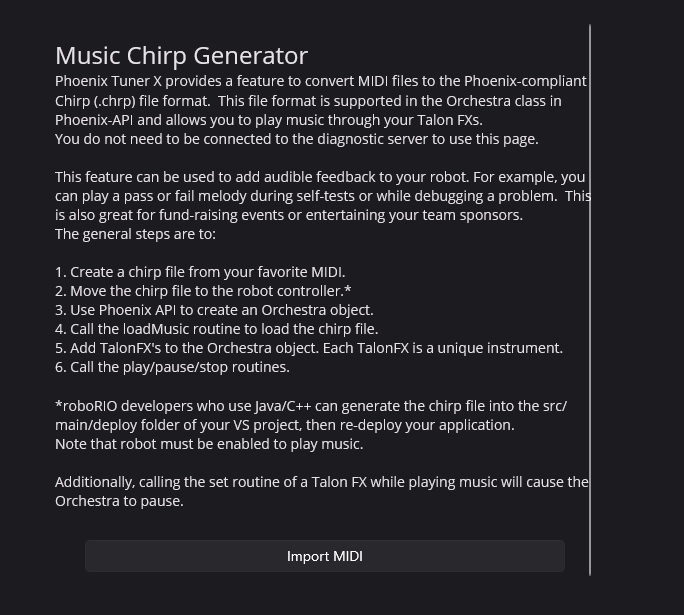
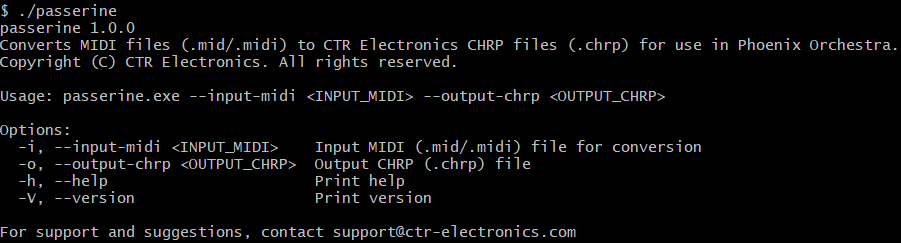

CHRP Converter
==============

:doc:`Orchestra </docs/api-reference/api-usage/orchestra>` uses CHRP files to play music using compatible Talon FX® motors. Tuner offers the ability to convert `MIDI <https://en.wikipedia.org/wiki/MIDI>`__ soundtracks to compatible CHRPs. Simply follow the on-screen instructions and press :guilabel:`Import MIDI`.

``passerine`` CLI
-----------------

In addition to the Tuner X CHRP Converter, the ``passerine`` CLI tool can be used from a terminal to convert MIDI files to CHRP. ``passerine`` can be downloaded from the `CLI Tools download page <https://docs.ctr-electronics.com/cli-tools>`__.

To view a list of available commands, run ``passerine`` either with no parameters or with ``--help``.

